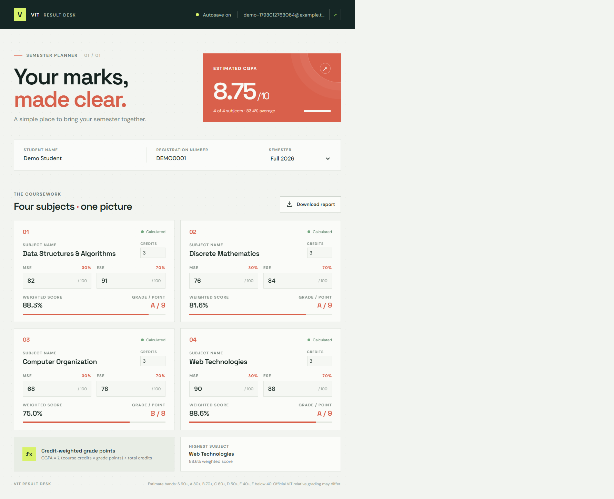

# VIT Result Desk

A React semester result calculator with account sign-in, autosaved marks, MSE/ESE weighting, and an estimated credit-weighted CGPA.



## Run locally

```sh
npm install
npm run dev
```

Open <http://localhost:5173>. The dev command starts the Vite app and its local Express API together. For a built app, run `npm run build` and then `npm run server`.

## CGPA estimate

Each subject score is `MSE × 0.30 + ESE × 0.70`. The grade-point estimate uses fixed score bands: S (90+), A (80+), B (70+), C (60+), D (50+), E (40+), and F (below 40), mapped to 10 through 0 points. CGPA is weighted by the credits entered for each completed subject; new subjects start at 3 credits. VIT may use relative grading, so these bands are estimates, not an official result.

## Local account storage

The local API stores users and their results in `data/users.json`, which is git-ignored. Passwords are stored as scrypt hashes; session cookies are HTTP-only and sessions expire after seven days or a server restart. This lightweight local authentication is intended for a student project/demo, not deployment with real student records. A public deployment needs HTTPS, a production database, rate limiting, persistent session storage, and a reviewed authentication provider or security design.
